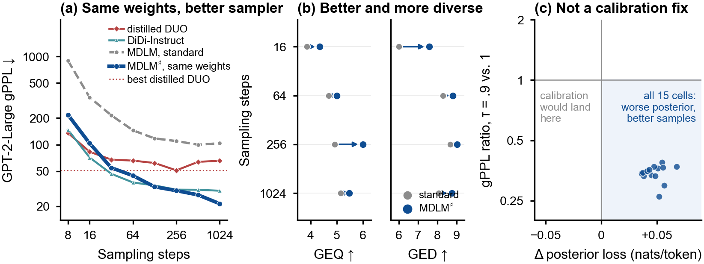

# Simple Diffusion Language Models Are More Effective Few-Step Generators Than Reported

An unchanged masked diffusion language model (MDLM) checkpoint, sampled at
temperature 0.9 with fp32 categorical draws, reaches lower generative
perplexity in 16 steps than its standard sampler does in 1,024.
**GroupEval** tests whether a change like this actually improves generation by
judging outputs in groups, so that repetition across outputs is visible. The
finite-step analysis explains why improving a denoiser and improving its
sampler are different objectives.



Choose a starting point:

- **Use GroupEval on your own generations:** [working example and evaluation guide](group-eval/README.md).
- **Inspect and replot the paper's results:** [compact data and figure map](paper_data/README.md).
- **Check the finite-step analysis:** [standalone theory verifiers](theory/README.md).
- **Run new sampling experiments:** [model and sampler guide](code/README.md).

## CPU quick start

Use Python 3.10 or newer. From this directory:

```bash
python -m venv .venv
source .venv/bin/activate        # Windows: .venv\Scripts\activate
python -m pip install -r requirements.txt

# Rebuild all nine paper figures into build/figures/.
python analysis/make_iclr_figures.py

# Validate and score a complete synthetic GroupEval example.
python group-eval/examples/run_offline.py --output-dir build/groupeval-example

# Check finite-step identities, exact repair, and GED properties.
python theory/verify_refined_theory.py --output build/theory/finite_step_checks.json

# Reproduce all 280 random-target theory examples (allow a few minutes).
python theory/verify_generic_suboptimality.py --output build/theory/random_target_checks.json
```

## GroupEval in one paragraph

Perplexity and token entropy grade one output at a time, so they cannot tell
when a generator keeps producing the same good text. GroupEval shows a blinded
judge groups of eight outputs. The judge scores each output for readability,
coherence, substance, and non-degeneration, and sorts valid outputs into
meaningfully distinct modes. Deterministic code then produces two scores on a
0–10 scale. **GEQ** asks whether each output is good: it is mean quality, with
invalid outputs counted as zero. **GED** asks whether the outputs say different
things: it is validity-weighted, normalized mode entropy. Report them
separately. High GEQ with low GED means good but similar outputs, and high GED
with low GEQ means varied but weak ones. The paper uses the GPT-OSS-120B judge
and two fixed partitions of each sample pool. The
[GroupEval guide](group-eval/README.md) covers the offline example, the input
format for new generators, request preview, scoring, and the
[paper-default profile](group-eval/protocol/paper_default.yaml).

## What is included

| Directory | Purpose |
| --- | --- |
| `analysis/` | One figure builder for all current paper figures. |
| `paper_data/` | Compact sampler grids, cross-model results and checkpoint manifest, and large-model controls. |
| `results/` | Published posterior-loss contrasts and matched sampling-cost measurements. |
| `group-eval/` | Protocol, prompts, schemas, scorer, request runner, examples, tests, and current-paper aggregate results. |
| `theory/` | Two CPU verifiers and their reference results. |
| `code/` | MDLM/DUO/SEDD implementation and selected experiment drivers. |
| `didi-instruct/`, `fast-dllm/` | Upstream model and evaluation components. |

The [GroupEval result map](group-eval/results/README.md) links each paper
analysis to its files: five MDLM judge series, three DiDi judge series, the
matched cross-model study, common causal-LM rescoring, and the conditional
task-quality check. The [supporting measurement guide](results/README.md)
describes the posterior-loss and sampling-cost protocols and units.

## Data availability

The release contains aggregates, not raw generations, individual judgments,
per-sequence observations, or model weights. The aggregates are enough to
inspect the reported results. GroupEval itself works on your own saved generations
without any of these archives. GPU generation and hosted judging have their own
dependencies, described in the component guides.

## Credits and licenses

This codebase uses code from [DUO](https://github.com/s-sahoo/duo) for MDLM and
SEDD ([Apache-2.0](code/LICENSE)), [DiDi-Instruct](https://github.com/haoyangzheng-ai/didi-instruct)
for DiDi models and evaluation ([MIT](didi-instruct/LICENSE.md)), and
[Fast-dLLM](https://github.com/NVlabs/Fast-dLLM) for Dream and LLaDA
([Apache-2.0](fast-dllm/LICENSE)). GroupEval is available under its
[MIT license](group-eval/LICENSE).
